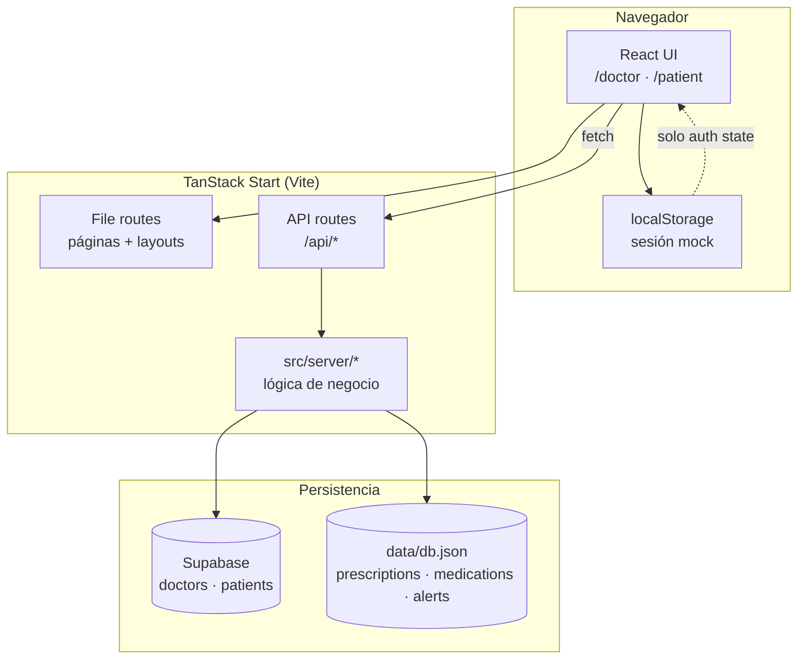
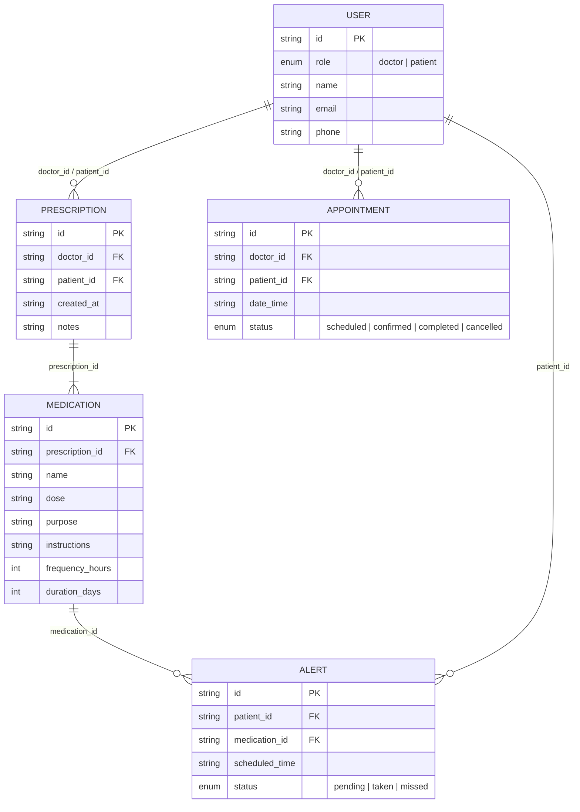
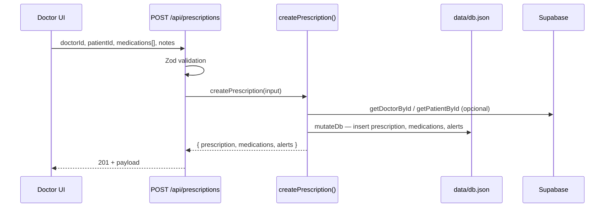
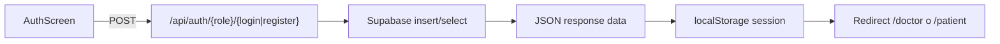

# Care Sync — Análisis del sistema actual

**Proyecto:** `health-harmony-portal`  
**Producto:** Care Sync — Sistema médico interactivo (MVP / prototipo)  
**Fecha del análisis:** Mayo 2026  
**Referencia de requisitos:** [`docs/prd.md`](./prd.md)

---

## 1. Resumen ejecutivo

Care Sync es una aplicación web de **doble portal** que conecta **doctores** y **pacientes** para digitalizar recetas, gestionar citas (UI preparada) y mejorar la **adherencia al tratamiento** mediante alertas de medicación.

El repositorio implementa un **MVP híbrido**:

| Capa | Estado actual |
|------|----------------|
| **Frontend** | Completo en UI (React 19 + TanStack Router/Start + Tailwind 4 + shadcn/Radix) |
| **Autenticación** | Funcional vía **Supabase** (tablas `doctors` y `patients`) |
| **Dominio clínico** (recetas, medicamentos, alertas) | Persistido en **`data/db.json`** (archivo local) |
| **Citas** | Modelo definido en tipos/BD local; **sin API ni persistencia** |
| **Notificaciones push / cron** | **No implementados** (solo generación de registros `alerts`) |
| **Portal paciente — datos reales** | Dashboard, recetas y citas usan **datos mock** en el cliente |

La arquitectura prioriza demostrar el flujo **crear receta → generar alertas**, mientras que gran parte de la experiencia visual del paciente y del doctor sigue siendo **prototipo estático**.

---

## 2. Stack tecnológico

### 2.1 Frontend y framework full-stack

| Tecnología | Versión / uso |
|------------|----------------|
| **React** | 19.x |
| **TanStack Start** | SSR + API routes en el mismo proyecto (`@tanstack/react-start`) |
| **TanStack Router** | Enrutamiento basado en archivos (`src/routes/*`) |
| **Vite** | 7.x — bundler y dev server |
| **TypeScript** | 5.8 |
| **Tailwind CSS** | 4.x con tokens de diseño en `src/styles.css` |
| **Radix UI + shadcn** | Componentes en `src/components/ui/*` |
| **React Hook Form + Zod** | Validación en formularios y APIs |
| **Lucide React** | Iconografía |
| **date-fns** | Disponible (uso limitado en pantallas actuales) |

### 2.2 Backend embebido (API routes)

Las rutas bajo `/api/*` se definen como **server handlers** de TanStack Router (no Express separado). Ejecutan lógica en `src/server/*` durante el request.

### 2.3 Persistencia

| Almacén | Contenido | Acceso |
|---------|-----------|--------|
| **Supabase (PostgreSQL)** | Doctores y pacientes registrados | `@supabase/supabase-js` vía `src/server/supabase.ts` |
| **`data/db.json`** | Usuarios seed, recetas, medicamentos, alertas, citas (vacío) | `src/server/database.ts` — lectura/escritura con cola de escritura |

### 2.4 Despliegue previsto

- **Cloudflare Workers** — `wrangler.jsonc` apunta a `@tanstack/react-start/server-entry` con `nodejs_compat`.
- Variables: `VITE_SUPABASE_URL`, `VITE_SUPABASE_ANON_KEY` (inyectadas en build por el preset Lovable).

---

## 3. Arquitectura del sistema

### 3.1 Vista de capas



### 3.2 Patrón de aplicación

1. **Monolito full-stack TypeScript** — una sola base de código; el servidor y el cliente comparten tipos (`src/server/database.ts`).
2. **Enrutamiento por convención** — cada archivo en `src/routes/` exporta `Route` con `createFileRoute`; `routeTree.gen.ts` se genera automáticamente.
3. **Guardas de ruta en cliente** — `beforeLoad` en `/doctor` y `/patient` redirige según `localStorage` (no hay JWT ni cookies de sesión en servidor).
4. **Dual store de identidades** — IDs de Supabase (UUID) coexisten con IDs seed (`doc-1`, `pat-1`) en `db.json`; `createPrescription` resuelve doctor/paciente en ambos orígenes.

### 3.3 Estructura de directorios relevante

```
health-harmony-portal/
├── data/db.json                 # BD de prototipo (dominio clínico)
├── docs/
│   ├── prd.md                   # Requisitos de producto
│   └── analisis-sistema.md      # Este documento
├── supabase/migrations/         # Esquema SQL auth
├── src/
│   ├── routes/                  # Páginas + API (TanStack Router)
│   ├── server/                  # Lógica servidor (DB, auth, recetas)
│   ├── lib/auth.ts              # Cliente: sesión en localStorage
│   ├── components/              # Layouts, AuthScreen, UI kit
│   └── styles.css               # Design tokens Care Sync
└── wrangler.jsonc               # Deploy Cloudflare
```

---

## 4. Modelo de datos

### 4.1 Esquema conceptual (PRD vs implementación)

El PRD define un modelo unificado con tabla `Users` y rol `doctor|patient`. La implementación **separó** identidades:

- **Supabase:** tablas independientes `doctors` y `patients` (sin tabla `users` unificada en producción).
- **JSON local:** tabla lógica `users[]` con campo `role` para datos de demostración.

### 4.2 Diagrama entidad-relación (dominio clínico en `db.json`)



### 4.3 Tipos TypeScript (`src/server/database.ts`)

| Entidad | Campos clave | Notas |
|---------|--------------|-------|
| `User` | `id`, `role`, `name`, `email`, `phone` | Solo en JSON; no sincronizado con Supabase |
| `Prescription` | `doctor_id`, `patient_id`, `notes`, `created_at` | Cabecera de receta |
| `Medication` | `frequency_hours`, `duration_days`, `dose`, `purpose`, `instructions` | `dose` es texto libre (ej. "1 cápsula") |
| `AlertLog` | `scheduled_time` ISO, `status` | Una fila por toma programada |
| `Appointment` | `date_time`, `status` | Array vacío en datos actuales |

### 4.4 Supabase — tablas de autenticación (prototipo)

**`public.doctors`**

| Columna | Tipo | Descripción |
|---------|------|-------------|
| `id` | `uuid` PK | `gen_random_uuid()` |
| `name` | `text` | Nombre completo |
| `email` | `text` UNIQUE | Normalizado a minúsculas en app |
| `specialty` | `text` | Default `'Medicina General'` |
| `password` | `text` | **Texto plano** (solo prototipo) |
| `created_at` | `timestamptz` | Auditoría |

**`public.patients`**

| Columna | Tipo | Descripción |
|---------|------|-------------|
| `id` | `uuid` PK | |
| `name` | `text` | |
| `email` | `text` UNIQUE | |
| `password` | `text` | **Texto plano** |
| `created_at` | `timestamptz` | |

**RLS:** habilitado con políticas `anon`/`authenticated` de **lectura e inserción abiertas** (`using (true)`). Comentario en migraciones: reemplazar en producción.

### 4.5 Relaciones y cardinalidad

| Relación | Cardinalidad | Integridad |
|----------|--------------|------------|
| Prescription → Doctor | N:1 | Validación en `createPrescription` (local o Supabase) |
| Prescription → Patient | N:1 | Idem |
| Medication → Prescription | N:1 | `prescription_id` obligatorio |
| Alert → Medication | N:1 | Generadas en cascada al crear receta |
| Alert → Patient | N:1 | Redundante con paciente de la receta (denormalizado para consultas) |
| Appointment → Doctor/Patient | N:1 | **Sin implementación de CRUD** |

**Observación:** No hay claves foráneas reales en JSON; la integridad es solo lógica en aplicación.

### 4.6 Estado actual de `data/db.json` (ejemplo real)

- **3 usuarios seed** (`doc-1`, `pat-1`, `pat-2`).
- **2 recetas** — una con IDs seed, otra con UUIDs de Supabase (doctor/paciente registrados en producción de prueba).
- **Decenas de alertas** generadas automáticamente por frecuencia/duración.
- **`appointments`: []** — sin datos.

---

## 5. Lógica de negocio

### 5.1 Flujo: doctor crea receta (implementado)



**Pantalla:** `/doctor/prescriptions/new` — formulario dinámico de medicamentos, búsqueda de pacientes vía `GET /api/patients?query=`.

**Campos del medicamento en UI:**

- `frequency` y `duration` se envían como **números** (`frequencyHours`, `durationDays`).
- En la UI el placeholder sugiere horas/días (ej. frecuencia `8` = cada 8 horas).

### 5.2 Algoritmo de generación de alertas

Ubicación: `src/server/prescriptions.ts` → `createPrescription`.

```typescript
// Pseudocódigo equivalente al código real
const now = new Date();
const totalHours = durationDays * 24;
for (let elapsedHours = 0; elapsedHours < totalHours; elapsedHours += frequencyHours) {
  scheduledDate = now + elapsedHours horas;
  crear AlertLog { status: "pending", scheduled_time: ISO };
}
```

**Propiedades del algoritmo:**

| Aspecto | Comportamiento |
|---------|----------------|
| Punto de inicio | `created_at` de la receta (= `now` al guardar) |
| Paso | `frequency_hours` (entero positivo) |
| Límite | Hasta `duration_days × 24` horas |
| Estados iniciales | Todas `pending` |
| Zona horaria | Depende del servidor Node (`Date` local) |

**Ejemplo:** `frequency_hours: 3`, `duration_days: 4` → 32 alertas (0, 3, 6, …, 93 horas).

**No implementado (según PRD):**

- Cron que marque `missed` si pasa la hora.
- Push notifications / Web Push.
- Alertas de cita (24 h / 1 h antes).

### 5.3 Flujo: paciente marca alerta como tomada (API lista, UI no)

- **Endpoint:** `PATCH /api/alerts/:id` con body `{ status: "pending" | "taken" | "missed" }`.
- **Implementación:** `updateAlertStatus` en `mutateDb`.
- **UI paciente (`/patient`):** botón "Marcar como tomada" **sin `fetch`** — datos hardcodeados (Amoxicilina, horarios ficticios).

### 5.4 Búsqueda de pacientes

`GET /api/patients?query=` → `getPatientsByName`:

1. Intenta `searchPatients` en Supabase (orden por nombre, filtro en memoria).
2. Si Supabase devuelve resultados → mapea a forma `User` con `phone: ""`.
3. Si falla o vacío → fallback a `db.users` con `role === "patient"`.

### 5.5 Citas

- Tipo `Appointment` y array en schema existen.
- **No hay** rutas API, pantallas de doctor/paciente conectadas ni escritura en JSON.
- UIs de calendario y citas usan **arrays constantes** en componentes React.

---

## 6. Autenticación y sesión

### 6.1 Flujo de registro / login



| Rol | Login API | Register API | Clave localStorage |
|-----|-----------|--------------|-------------------|
| Doctor | `/api/auth/doctor/login` | `/api/auth/doctor/register` | `care-sync-doctor-session` |
| Patient | `/api/auth/patient/login` | `/api/auth/patient/register` | `care-sync-patient-session` |

**Sesión (`MockSession`):** `{ id, name, email, role, specialty? }` — **no incluye token** ni expiración.

### 6.2 Protección de rutas

- **`/doctor/*`** y **`/patient/*`:** `beforeLoad` en layout padre verifica `getDoctorSession()` / `getPatientSession()`.
- Solo corre en **`typeof window !== "undefined"`** (SSR no aplica guard en servidor).
- Rutas públicas de auth: `/doctor/login`, `/doctor/register`, `/patient/login`, `/patient/register`.
- Parámetro `?redirect=` guardado en login pero uso limitado tras auth exitosa.

### 6.3 Seguridad (estado prototipo)

| Riesgo | Detalle |
|--------|---------|
| Contraseñas en claro | Columna `password` en Supabase; comparación directa en login |
| Sin autorización en APIs | `POST /api/prescriptions` y `PATCH /api/alerts/:id` no validan sesión del doctor/paciente |
| RLS abierto | Cualquier cliente con `anon key` puede leer/insertar doctores y pacientes |
| Sesión solo cliente | Manipulación de `localStorage` podría suplantar identidad en UI (APIs no verifican) |

---

## 7. API REST (implementada)

| Método | Ruta | Handler | Descripción |
|--------|------|---------|-------------|
| `POST` | `/api/auth/doctor/login` | `loginDoctorFromDb` | Login doctor |
| `POST` | `/api/auth/doctor/register` | `registerDoctorInDb` | Alta doctor |
| `POST` | `/api/auth/patient/login` | `loginPatientFromDb` | Login paciente |
| `POST` | `/api/auth/patient/register` | `registerPatientInDb` | Alta paciente |
| `GET` | `/api/patients?query=` | `getPatientsByName` | Listado/búsqueda pacientes |
| `POST` | `/api/prescriptions` | `createPrescription` | Crear receta + meds + alertas |
| `PATCH` | `/api/alerts/:id` | `updateAlertStatus` | Actualizar estado de alerta |

### 7.1 Contrato `POST /api/prescriptions`

**Request (Zod):**

```json
{
  "doctorId": "uuid-o-doc-1",
  "patientId": "uuid-o-pat-1",
  "notes": "opcional",
  "medications": [
    {
      "name": "string",
      "dose": "string",
      "purpose": "string",
      "instructions": "string (default \"\")",
      "frequencyHours": 8,
      "durationDays": 7
    }
  ]
}
```

**Response 201:**

```json
{
  "data": {
    "prescription": { "...": "..." },
    "medications": [ "..." ],
    "alerts": [ "..." ]
  }
}
```

**Errores:** `400` validación / `medications_required`, `404` doctor/patient not found, `500` interno.

### 7.2 Persistencia JSON — concurrencia

`writeDb` encadena escrituras con una **cola de promesas** (`writeQueue`) para evitar condiciones de carrera al escribir `db.json` en requests concurrentes.

---

## 8. Frontend: rutas y experiencia de usuario

### 8.1 Mapa de rutas

| Ruta | Tipo | Datos |
|------|------|-------|
| `/` | Landing | Estática |
| `/doctor/login`, `/doctor/register` | Auth | API Supabase |
| `/doctor` | Dashboard doctor | **Mock** |
| `/doctor/calendar` | Calendario | **Mock** |
| `/doctor/patients` | Lista pacientes | **Mock** |
| `/doctor/prescriptions/new` | Crear receta | **API real** |
| `/patient/login`, `/patient/register` | Auth | API Supabase |
| `/patient` | Dashboard adherencia | **Mock** |
| `/patient/prescriptions` | Bóveda recetas | **Mock** |
| `/patient/appointments` | Citas | **Mock** |
| `/patient/profile` | Perfil | Sesión real + campos mock |

### 8.2 Navegación (según PRD)

**Doctor (sidebar desktop + bottom tab móvil):**

- Dashboard → `/doctor`
- Calendario → `/doctor/calendar`
- Pacientes → `/doctor/patients`
- Crear Receta → `/doctor/prescriptions/new`

**Paciente (bottom tab):**

- Hoy → `/patient`
- Mis Recetas → `/patient/prescriptions`
- Citas → `/patient/appointments`
- Perfil → `/patient/profile`

### 8.3 Layouts

- **`DoctorLayout`:** sidebar fijo ≥ `md`, barra inferior en móvil, tarjeta de sesión y logout.
- **`PatientLayout`:** header con logo, campana de notificaciones (decorativa), contenido centrado `max-w-5xl`, bottom nav.

### 8.4 Pantalla funcional destacada: Nueva receta

Archivo: `src/routes/doctor.prescriptions.new.tsx`

- Carga pacientes con debounce implícito vía `useEffect` al cambiar búsqueda.
- Formulario multi-medicamento (agregar/eliminar filas).
- Validación cliente antes de `POST`.
- Mensaje de éxito confirma generación automática de alertas.
- Botón "Guardar borrador" **sin implementar**.

---

## 9. Diseño visual y UX

### 9.1 Identidad (Care Sync)

Definido en `src/styles.css` y alineado al PRD:

| Token | Valor / intención |
|-------|-------------------|
| Primario | Azul médico ~ `#0052FF` (`oklch(0.55 0.22 260)`) |
| Éxito | Verde menta ~ `#10B981` |
| Fondo | Blanco / gris suave `#F8FAFC` |
| Tipografía | **Plus Jakarta Sans** (Google Fonts) |
| Radios | `--radius: 1rem`, tarjetas `rounded-3xl` |
| Sombras | `--shadow-soft`, `--shadow-card` |
| Gradientes | `--gradient-primary`, `--gradient-success`, `--gradient-hero` |

### 9.2 Accesibilidad (intención de diseño)

- Tipografía grande (`text-base` mínimo en cuerpo, títulos `text-3xl`+).
- Botones táctiles `min-h-14` / `min-h-16` en acciones críticas.
- Alto contraste en hero y CTAs.
- Estados visuales claros: `pending`, `taken`, `next` en listas de horario.

### 9.3 Componentes UI

Kit **shadcn/ui** completo en `src/components/ui/` (Button, Card, Dialog, Form, Sidebar, etc.). Las pantallas de producto usan mayormente **HTML semántico + Tailwind** custom en lugar del kit compuesto.

### 9.4 Componentes de dominio

| Componente | Rol |
|------------|-----|
| `Logo` | Marca Care Sync |
| `AuthScreen` | Login/registro unificado por rol |
| `DoctorLayout` / `PatientLayout` | Shell de cada portal |

---

## 10. Brecha frente al PRD (matriz de cumplimiento)

| Requisito PRD | Estado |
|---------------|--------|
| Portal doctor — calendario interactivo | UI mock; sin backend |
| Portal doctor — prescription builder | **Implementado** (parcial: sin autocompletado de fármacos) |
| Portal doctor — gestión citas | No implementado |
| Portal paciente — dashboard adherencia | UI mock; sin lectura de `alerts` |
| Portal paciente — bóveda recetas | UI mock; sin `GET` de recetas |
| Portal paciente — agendar citas | UI mock |
| Motor de alertas push/in-app | Solo registros en JSON; sin push ni polling |
| Cron evaluación hora actual | No existe |
| Recordatorios de cita | No existe |
| Users unificados | Separado doctors/patients + users JSON legacy |
| Next.js / Expo | Usa **TanStack Start + Vite** (desvío técnico aceptable para MVP) |

---

## 11. Flujo de datos end-to-end (lo que sí funciona hoy)

1. Doctor se registra → fila en Supabase `doctors`.
2. Paciente se registra → fila en Supabase `patients`.
3. Doctor inicia sesión → sesión en `localStorage`.
4. Doctor abre **Nueva receta**, busca paciente → `GET /api/patients` devuelve pacientes Supabase.
5. Doctor envía receta → `POST /api/prescriptions` escribe en `db.json` receta, medicamentos y N alertas.
6. Paciente **no ve** esas recetas/alertas en su dashboard (aún mock).
7. Un cliente externo podría `PATCH /api/alerts/:id` para marcar `taken` (sin autenticación).

---

## 12. Consideraciones de despliegue y entorno

### 12.1 Desarrollo local

```bash
npm run dev   # Vite dev — TanStack Start
```

- `db.json` se crea automáticamente con seed si no existe (`ensureDatabaseFile`).
- Supabase opcional: sin variables, auth devuelve `503 supabase_not_configured`.

### 12.2 Producción (Cloudflare)

- El archivo `data/db.json` en Workers **no es durable** entre invocaciones/regiones sin almacenamiento externo (R2, D1, Supabase tables).
- Para producción real, el dominio clínico debería migrarse a **Supabase/Postgres** con el mismo modelo ER.

### 12.3 Variables de entorno

| Variable | Uso |
|----------|-----|
| `VITE_SUPABASE_URL` | Cliente Supabase |
| `VITE_SUPABASE_ANON_KEY` | Clave pública anon |

---

## 13. Recomendaciones técnicas (orden sugerido)

1. **Unificar persistencia** — tablas `prescriptions`, `medications`, `alerts`, `appointments` en Supabase con FKs y RLS por rol.
2. **API de lectura** — `GET /api/prescriptions?patientId=`, `GET /api/alerts?patientId=&from=&to=` para alimentar UI paciente.
3. **Conectar UI paciente** — reemplazar mocks en `/patient`, `/patient/prescriptions` con React Query.
4. **Autorización** — validar sesión (JWT Supabase Auth o cookies firmadas) en todos los handlers.
5. **Auth segura** — Supabase Auth con hash; eliminar columna `password` en tablas custom.
6. **Cron / Edge scheduled** — job que pase `pending` → `missed` y dispare notificaciones.
7. **Web Push** — Service Worker + suscripción por paciente.
8. **Citas** — CRUD completo y sincronización calendario doctor ↔ paciente.

---

## 14. Glosario

| Término | Significado en este proyecto |
|---------|------------------------------|
| **Care Sync** | Nombre comercial del producto |
| **Alerta** | Registro `AlertLog` — una toma de medicamento programada |
| **Adherencia** | Porcentaje de tomas marcadas como `taken` (métrica UI aún estática) |
| **Mock (UI)** | Datos hardcodeados en componentes, no provenientes del servidor |
| **MutateDb** | Patrón read-modify-write sobre `db.json` |

---

## 15. Referencias de código clave

| Responsabilidad | Archivo |
|-----------------|---------|
| Esquema y persistencia JSON | `src/server/database.ts` |
| Creación receta + alertas | `src/server/prescriptions.ts` |
| Auth Supabase doctor/paciente | `src/server/doctors.ts`, `src/server/patients.ts` |
| Sesión cliente | `src/lib/auth.ts` |
| API recetas | `src/routes/api.prescriptions.ts` |
| API alertas | `src/routes/api.alerts.$id.ts` |
| Formulario receta | `src/routes/doctor.prescriptions.new.tsx` |
| Design system | `src/styles.css` |
| Migraciones SQL | `supabase/migrations/001_doctors.sql`, `002_patients.sql` |

---

*Documento generado a partir del análisis del código fuente del repositorio `health-harmony-portal`. Para cambios de arquitectura, actualizar este archivo junto con el PRD.*
