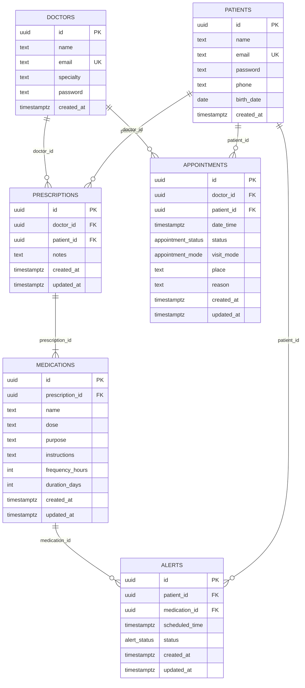
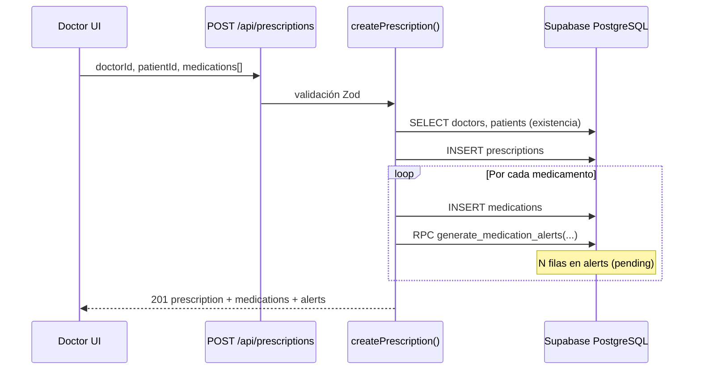
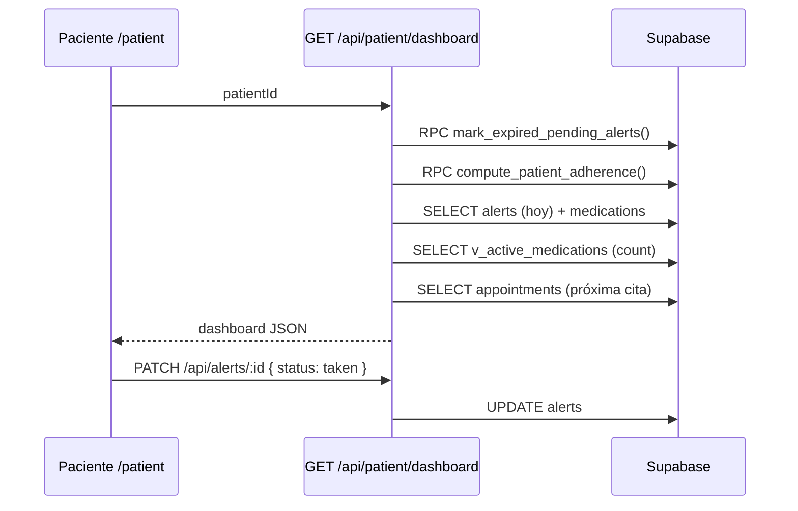
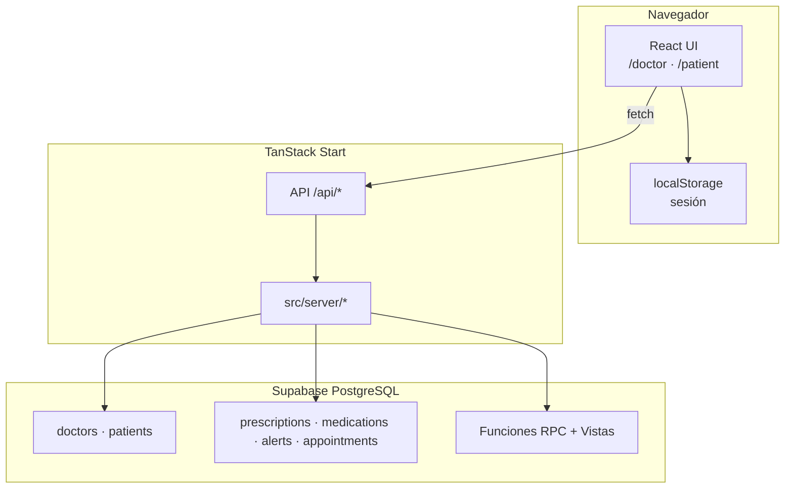

# Care Sync — Análisis del sistema y arquitectura de base de datos

**Proyecto:** `health-harmony-portal`  
**Producto:** Care Sync — Sistema médico interactivo (MVP / prototipo académico)  
**Última actualización:** Mayo 2026  
**Referencias:** [`docs/prd.md`](./prd.md) · [`supabase/migrations/README.md`](../supabase/migrations/README.md)

---

## 1. Resumen ejecutivo

Care Sync conecta **doctores** y **pacientes** para digitalizar recetas, gestionar citas y mejorar la **adherencia al tratamiento** mediante alertas de medicación programadas en base de datos.

El sistema persiste **todo el dominio clínico en Supabase (PostgreSQL)**. La aplicación (TanStack Start + React) accede a la BD vía `@supabase/supabase-js` desde handlers en `src/server/*`.

| Capa | Tecnología | Rol |
|------|------------|-----|
| **Frontend** | React 19, TanStack Router/Start, Tailwind 4 | Portales `/doctor` y `/patient` |
| **API** | Rutas `/api/*` (server handlers) | Orquestación y validación (Zod) |
| **Base de datos** | Supabase PostgreSQL | Auth, recetas, alertas, citas, métricas |
| **Sesión UI** | `localStorage` | Identidad del usuario logueado (prototipo) |

**Modelo de identidad:** tablas separadas `doctors` y `patients` (no tabla unificada `users`). Las relaciones clínicas entre doctor y paciente son **lógicas**, vía `prescriptions` y `appointments`.

---

## 2. Arquitectura de la base de datos

### 2.1 Diagrama entidad-relación



### 2.2 Relación lógica doctor ↔ paciente

No existe tabla puente `doctor_patients`. La relación **N:M** se materializa en:

| Tabla puente implícita | Significado |
|----------------------|-------------|
| `prescriptions` | El doctor recetó al paciente |
| `appointments` | El doctor tiene cita con el paciente |

La vista **`v_doctor_patient_relationship`** unifica ambos orígenes:

```sql
-- Prescripción O cita vincula doctor_id + patient_id
SELECT DISTINCT doctor_id, patient_id, 'prescription' AS link_source FROM prescriptions
UNION
SELECT DISTINCT doctor_id, patient_id, 'appointment'  AS link_source FROM appointments;
```

La app usa esta vista para listar “mis pacientes” del doctor (`getDoctorPatients`) y contar pacientes activos en el dashboard.

### 2.3 Tipos enumerados (ENUM)

| Tipo PostgreSQL | Valores | Uso |
|-----------------|---------|-----|
| `appointment_status` | `scheduled`, `confirmed`, `completed`, `cancelled` | Estado de cita |
| `appointment_mode` | `in_person`, `video` | Modalidad de consulta |
| `alert_status` | `pending`, `taken`, `missed` | Estado de toma de medicamento |

> **Nota:** la columna de modalidad se llama **`visit_mode`** (tipo `appointment_mode`). No se usa el nombre `mode` porque PostgreSQL lo reserva como agregado estadístico `mode()`.

### 2.4 Tablas de autenticación

#### `public.doctors`

| Columna | Descripción |
|---------|-------------|
| `id` | UUID, PK |
| `name`, `email` | Identidad; email único, normalizado a minúsculas en app |
| `specialty` | Default `'Medicina General'` |
| `password` | Texto plano (**solo prototipo académico**) |
| `created_at` | Auditoría |

#### `public.patients`

| Columna | Descripción |
|---------|-------------|
| `id` | UUID, PK |
| `name`, `email`, `password` | Igual que doctores |
| `phone`, `birth_date` | Perfil extendido (migración 003) |
| `created_at` | “Paciente desde …” en UI |

**RLS:** políticas abiertas `SELECT`/`INSERT`/`ALL` para `anon` y `authenticated` en tablas clínicas (prototipo; reemplazar en producción).

### 2.5 Tablas clínicas

#### `prescriptions` — cabecera de receta

- FK `doctor_id` → `doctors(id)`
- FK `patient_id` → `patients(id)`
- Trigger `set_updated_at` en UPDATE

#### `medications` — líneas de la receta

- FK `prescription_id` → `prescriptions(id)` ON DELETE CASCADE
- `frequency_hours` > 0, `duration_days` > 0 (CHECK)
- Campos clínicos: `name`, `dose`, `purpose`, `instructions`

#### `alerts` — motor de adherencia

- FK `patient_id` → `patients(id)`
- FK `medication_id` → `medications(id)`
- Una fila = **una toma programada** en `scheduled_time`
- Estado inicial: `pending`

#### `appointments` — agenda

- FK `doctor_id` → `doctors(id)`, `patient_id` → `patients(id)`
- `visit_mode`, `place`, `reason` para UI de citas presenciales/videollamada

### 2.6 Vistas analíticas

| Vista | Propósito |
|-------|-----------|
| `v_doctor_patient_relationship` | Pares doctor–paciente vinculados |
| `v_active_medications` | Medicamentos dentro de ventana `created_at + duration_days` |
| `v_doctor_today_appointments` | Citas del día por doctor (agenda) |

**Lógica de medicamento activo** (`v_active_medications`):

```sql
CASE
  WHEN now() <= prescription.created_at + (duration_days * interval '1 day')
  THEN 'active'
  ELSE 'completed'
END AS treatment_status
```

### 2.7 Índices principales

- `prescriptions(doctor_id)`, `prescriptions(patient_id)`
- `medications(prescription_id)`
- `alerts(patient_id)`, `alerts(medication_id)`, `alerts(scheduled_time)`, `alerts(status)`
- `appointments(doctor_id)`, `appointments(patient_id)`, `appointments(date_time)`
- `doctors(lower(email))`, `patients(lower(email))`

### 2.8 Orden de migraciones

Ver [`supabase/migrations/README.md`](../supabase/migrations/README.md). Secuencia `001`–`014`:

1. Auth (`doctors`, `patients`)
2. Perfil paciente (`phone`, `birth_date`)
3. Tablas clínicas + ENUMs
4. Funciones, triggers, vistas
5. RLS prototipo
6. Correcciones de esquema legacy (`visit_mode`, FKs hacia `doctors`/`patients`, grants RPC, vistas)

**Problema frecuente en despliegues manuales:** si `appointments` o `prescriptions` existían antes con esquema antiguo (FK a `users`, columnas faltantes), aplicar migraciones `008`–`013`.

### 2.9 Integridad referencial (resumen)

```
doctors ──┬── prescriptions ── medications ── alerts
          │         │
patients ─┴─────────┴── appointments
```

Todas las FKs clínicas deben apuntar a **`doctors`** y **`patients`**, no a una tabla `users` unificada del PRD original.

---

## 3. Algoritmos de base de datos

La lógica de negocio crítica vive en **PostgreSQL** (funciones PL/pgSQL y SQL) y se invoca vía **RPC Supabase** o consultas directas desde la app.

### 3.1 Algoritmo 1 — Generación de alertas de medicación

**Función:** `public.generate_medication_alerts`  
**Invocación:** RPC desde `createPrescription()` tras insertar cada `medication`  
**Permisos:** `GRANT EXECUTE` a `anon`, `authenticated` (migración 009)  
**Modo:** `SECURITY DEFINER` (ejecuta con privilegios del propietario)

#### Entradas

| Parámetro | Tipo | Descripción |
|-----------|------|-------------|
| `p_medication_id` | uuid | Medicamento recién creado |
| `p_patient_id` | uuid | Paciente de la receta |
| `p_frequency_hours` | int | Intervalo entre tomas (horas) |
| `p_duration_days` | int | Duración total del tratamiento |
| `p_starts_at` | timestamptz | Ancla temporal (default: `now()` UTC) |

#### Pseudocódigo

```
total_hours ← duration_days × 24
elapsed ← 0
inserted_count ← 0

MIENTRAS elapsed < total_hours:
  INSERT alert (
    patient_id,
    medication_id,
    scheduled_time = starts_at + elapsed horas,
    status = 'pending'
  )
  inserted_count ← inserted_count + 1
  elapsed ← elapsed + frequency_hours

RETORNAR inserted_count
```

#### Ejemplo numérico

| Parámetro | Valor |
|-----------|-------|
| `frequency_hours` | 8 |
| `duration_days` | 7 |
| Total alertas | ⌈(7×24)/8⌉ = **21** tomas (t=0, 8, 16, …, 160 h) |

#### Fallback en aplicación

Si el RPC falla (permisos, función ausente), `src/server/prescriptions.ts` replica el mismo algoritmo con **inserciones batch** en `alerts` desde TypeScript.

---

### 3.2 Algoritmo 2 — Marcado de alertas vencidas (cron lógico)

**Función:** `public.mark_expired_pending_alerts()`  
**Invocación:** al cargar dashboard paciente, reportes de adherencia del doctor, y consultas de alertas del día

#### Regla

```
PARA CADA alert WHERE status = 'pending' AND scheduled_time < now() UTC:
  status ← 'missed'
```

Retorna el número de filas actualizadas (`GET DIAGNOSTICS row_count`).

#### Semántica

| Estado | Significado |
|--------|-------------|
| `pending` | Toma futura o pendiente de acción |
| `taken` | Paciente marcó “tomada” (`PATCH /api/alerts/:id`) |
| `missed` | Pasó la hora programada sin confirmación |

**Fallback app:** si RPC falla, `UPDATE alerts SET status='missed' WHERE …` vía cliente Supabase.

---

### 3.3 Algoritmo 3 — Cálculo de adherencia

**Función:** `public.compute_patient_adherence(p_patient_id uuid)`  
**Tipo:** SQL estable (función pura sobre lectura)

#### Fórmula

```
adherencia = 100 × (alertas 'taken') / (alertas 'taken' + alertas 'missed')
```

- Alertas aún `pending` **no entran** en el denominador (tratamiento no resuelto).
- Si no hay alertas resueltas → **100%** por defecto (`COALESCE`).

#### Uso en UI

- Dashboard doctor: promedio de adherencia de sus pacientes
- Dashboard paciente: tarjeta “Adherencia esta semana”
- Lista de pacientes del doctor: barra de progreso por paciente

**Fallback app:** cuenta manual de filas en `alerts` si el RPC no está disponible.

---

### 3.4 Algoritmo 4 — Clasificación de medicamentos activos

Implementado en la **vista** `v_active_medications` (no es función, pero es regla de BD):

```
ends_at = prescription.created_at + duration_days días

SI now() <= ends_at  → treatment_status = 'active'
SI NO                → treatment_status = 'completed'
```

Alimenta:

- `GET /api/patient/prescriptions` — pestañas Activas / Pasadas
- Conteo de medicinas activas en dashboards

---

### 3.5 Flujo transaccional: crear receta completa



**Orden de operaciones:** receta → medicamento → alertas. Si fallan alertas tras crear medicamento, la receta queda parcial (prototipo; en producción usar transacción única).

---

### 3.6 Flujo transaccional: adherencia del paciente



---

## 4. Capa de aplicación ↔ base de datos

### 4.1 Módulos servidor

| Módulo | Responsabilidad BD |
|--------|-------------------|
| `src/server/supabase.ts` | Cliente singleton |
| `src/server/doctors.ts` | CRUD auth doctor |
| `src/server/patients.ts` | CRUD auth paciente, búsqueda |
| `src/server/prescriptions.ts` | Crear receta, RPC alertas, listado medicamentos |
| `src/server/alerts.ts` | Cron lógico, adherencia, agenda del día |
| `src/server/appointments.ts` | CRUD citas |
| `src/server/dashboard.ts` | Agregaciones doctor/paciente |
| `src/server/types.ts` | Tipos alineados al esquema SQL |

### 4.2 API REST conectada a Supabase

| Método | Ruta | Operaciones BD |
|--------|------|----------------|
| POST | `/api/auth/doctor/*`, `/api/auth/patient/*` | `doctors`, `patients` |
| GET | `/api/patients`, `/api/doctors` | Búsqueda |
| POST | `/api/prescriptions` | `prescriptions`, `medications`, RPC alertas |
| PATCH | `/api/alerts/:id` | `UPDATE alerts.status` |
| GET/POST | `/api/appointments` | `appointments` |
| PATCH | `/api/appointments/:id` | Estado de cita |
| GET | `/api/doctor/dashboard` | Citas hoy, adherencia, `v_doctor_patient_relationship` |
| GET | `/api/doctor/patients` | Vista relación + métricas |
| GET | `/api/doctor/missed-alerts` | Alertas `missed` + join medicamentos |
| GET | `/api/patient/dashboard` | Alertas, adherencia, citas |
| GET | `/api/patient/prescriptions` | `v_active_medications` |
| GET | `/api/patient/profile` | `patients` |

### 4.3 Tipos TypeScript (`src/server/types.ts`)

Espejo del esquema SQL: `Prescription`, `Medication`, `AlertLog`, `Appointment`, enums de estado.

---

## 5. Arquitectura del sistema (vista general)



**Patrón:** monolito full-stack TypeScript; la BD concentra reglas de scheduling y métricas; la app orquesta flujos y renderiza UI.

---

## 6. Pantallas y fuentes de datos (estado actual)

| Ruta | Fuente de datos |
|------|-----------------|
| `/doctor` | `GET /api/doctor/dashboard` |
| `/doctor/patients` | `GET /api/doctor/patients` |
| `/doctor/calendar` | `GET /api/appointments?doctorId=` |
| `/doctor/prescriptions/new` | `POST /api/prescriptions`, `GET /api/patients` |
| `/doctor/alerts` | `GET /api/doctor/missed-alerts` |
| `/patient` | `GET /api/patient/dashboard`, `PATCH /api/alerts/:id` |
| `/patient/prescriptions` | `GET /api/patient/prescriptions` |
| `/patient/appointments` | `GET/POST /api/appointments` |
| `/patient/profile` | `GET /api/patient/profile` |

---

## 7. Seguridad y limitaciones (prototipo)

| Aspecto | Estado |
|---------|--------|
| Contraseñas | Texto plano en `doctors` / `patients` |
| Sesión | Solo `localStorage`; APIs no validan JWT |
| RLS | Políticas abiertas en tablas clínicas |
| Notificaciones push | No implementadas; alertas solo en BD + UI |
| Cron real | Simulado al consultar (`mark_expired_pending_alerts`) |
| Transacciones | Receta + alertas no están en una sola TX SQL |

---

## 8. Brecha frente al PRD

| Requisito PRD | Estado |
|---------------|--------|
| Crear receta + alertas automáticas | **Implementado** (BD + API) |
| Paciente marca toma | **Implementado** (`PATCH /api/alerts/:id`) |
| Dashboard adherencia | **Implementado** (RPC + UI) |
| Citas doctor ↔ paciente | **Implementado** (CRUD básico) |
| Tabla `Users` unificada | **No** — `doctors` + `patients` |
| Push / Web Push | Pendiente |
| Cron programado (Edge/pg_cron) | Pendiente — lógica existe, invocación es on-read |
| Supabase Auth con hash | Pendiente |

---

## 9. Glosario

| Término | Definición |
|---------|------------|
| **Alerta** | Fila en `alerts`: una toma programada en `scheduled_time` |
| **Adherencia** | % de tomas `taken` sobre (`taken` + `missed`) |
| **Relación doctor–paciente** | Par vinculado por receta o cita (vista unificada) |
| **RPC** | Llamada a función PostgreSQL vía Supabase (`supabase.rpc`) |
| **visit_mode** | Columna de modalidad de cita (`in_person` / `video`) |

---

## 10. Referencias de código y SQL

| Responsabilidad | Ubicación |
|-----------------|-----------|
| Esquema SQL completo | `supabase/migrations/001`–`014` |
| Funciones y vistas | `supabase/migrations/005_functions_views.sql` |
| Grants RPC | `supabase/migrations/009_grants_and_rpc.sql` |
| Crear receta + alertas | `src/server/prescriptions.ts` |
| Algoritmos alertas/adherencia | `src/server/alerts.ts` |
| Dashboards | `src/server/dashboard.ts` |
| Tipos dominio | `src/server/types.ts` |

---

*Documento alineado con el estado del repositorio tras migración completa a Supabase. Para cambios de esquema, actualizar migraciones SQL y este archivo.*
